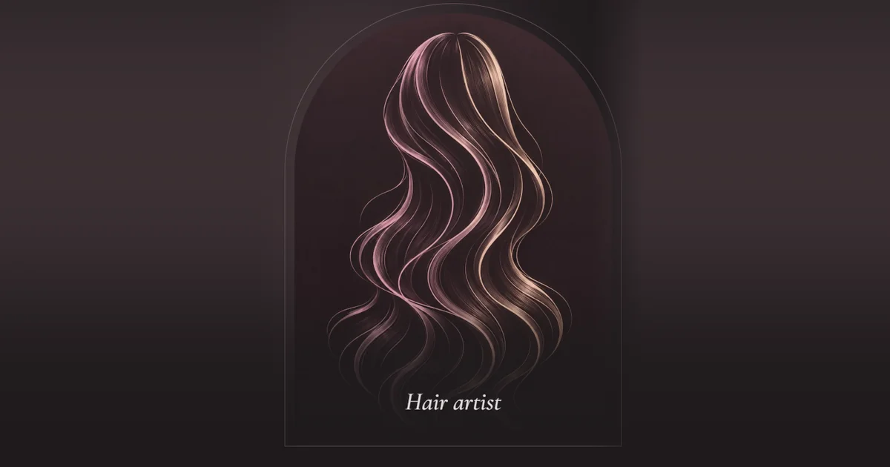

# Oday Shami Salon — Bilingual Page

One page, two languages: a ladies' salon site with a full Arabic ↔ English (RTL ↔ LTR) switch.

**Live:** [hair-salon-nine-hazel.vercel.app](https://hair-salon-nine-hazel.vercel.app) · Part of my [portfolio](https://aya-khamaysa-portfolio.vercel.app)



## Highlights

- **One-click language switch** that flips the whole layout (RTL ↔ LTR) and remembers the choice.
- **Logical CSS utilities** (`ms-`, `ps-`, `border-s`, `end-`, `text-start`), so no second stylesheet is needed.
- **Each language has its own fonts.**
- Animated SVG hair and soft motion.

## Built with

React · Framer Motion · Tailwind CSS · Vite

## Run locally

```bash
npm install
npm run dev
```

## Edit
- All texts (`ar` and `en`): `src/data/content.js`
- Language switch: `src/useLanguage.js` (sets `<html lang>` and `<html dir>`)

---

Designed & built by **Aya Khamaysa** · [Portfolio](https://aya-khamaysa-portfolio.vercel.app) · [LinkedIn](https://www.linkedin.com/in/ayakhamaysa) · [One Click](https://www.instagram.com/oneclick.ps)
